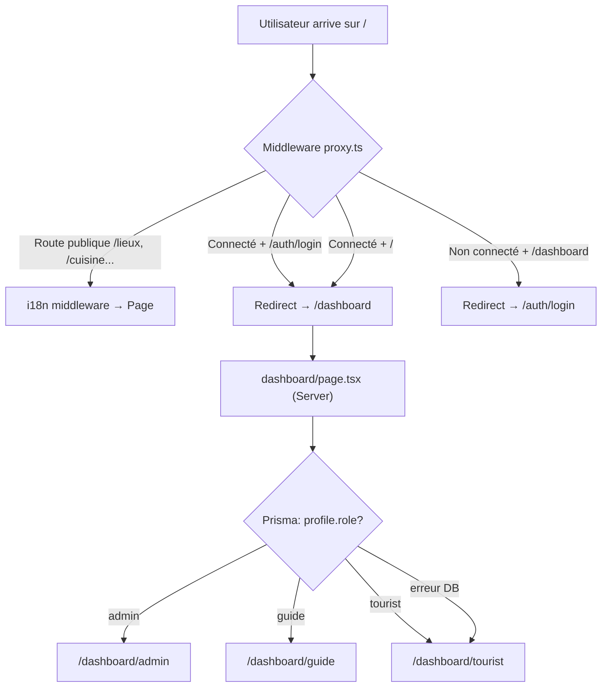
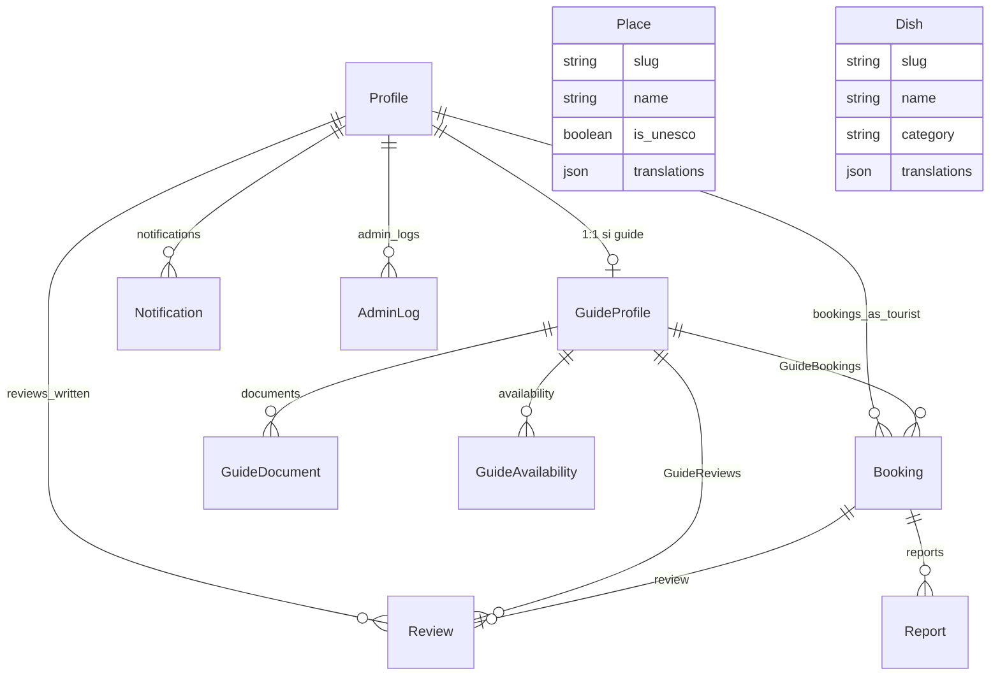

# 🏛️ Architecture Complète — HeriTogo Frontend

## 1. Vue d'ensemble

**HeriTogo** est une PWA de tourisme et patrimoine culturel togolais, déployée sur [heritogo.codorah.com](https://heritogo.codorah.com).

| Aspect | Choix |
|--------|-------|
| **Framework** | Next.js 16 (App Router) |
| **Langage** | TypeScript |
| **Styling** | Tailwind CSS v4 + DaisyUI v5 (config dans `globals.css`) |
| **Auth** | Supabase `@supabase/ssr` |
| **BDD** | PostgreSQL via Prisma ORM |
| **i18n** | `next-intl` — 4 langues : `fr` (défaut), `en`, `es`, `zh` |
| **Animations** | Framer Motion |
| **Icônes** | Lucide React |
| **Cartes** | Leaflet + React-Leaflet |
| **Notifications** | Sonner |
| **Déploiement** | Vercel |

---

## 2. Arborescence clé

```
heritogo_frontend/
├── app/
│   ├── globals.css                  ← Config Tailwind v4 + DaisyUI tokens
│   ├── _components/                 ← Composants au niveau app (Navbar proxy, ChatBot, CookieConsent…)
│   ├── api/                         ← Routes API Next.js
│   │   ├── admin/                   ← API admin (CRUD catalogue, modération)
│   │   ├── auth/                    ← Callbacks OAuth
│   │   ├── bookings/                ← Réservations
│   │   ├── chatbot/                 ← IA conversationnelle
│   │   ├── dishes/                  ← CRUD plats
│   │   ├── guide/ + guides/         ← Profils guides
│   │   ├── hotels/                  ← Hôtels
│   │   ├── kyc/                     ← Vérification d'identité guides
│   │   ├── places/                  ← CRUD lieux/monuments
│   │   ├── profile/                 ← Profil utilisateur
│   │   ├── reports/                 ← Signalements
│   │   ├── reviews/                 ← Avis
│   │   ├── scan/                    ← Scanner IA vision
│   │   ├── tourist/                 ← API touriste
│   │   └── upload/                  ← Upload fichiers
│   └── [locale]/                    ← Routes internationalisées
│       ├── layout.tsx               ← Layout racine (fonts, SEO, AdSense, Navbar, Footer)
│       ├── page.tsx                 ← Page d'accueil (hero carousel, sections)
│       ├── error.tsx                ← Error boundary global
│       ├── loading.tsx              ← Loading skeleton
│       ├── (auth)/                  ← Groupe route auth (layout sans navbar)
│       │   └── auth/                ← Login, Register, Forgot Password
│       ├── dashboard/
│       │   ├── page.tsx             ← Redirecteur par rôle (admin→/admin, guide→/guide, tourist→/tourist)
│       │   ├── admin/               ← Dashboard admin (modération, catalogue, logs)
│       │   ├── guide/               ← Dashboard guide (réservations, profil pro)
│       │   └── tourist/             ← Dashboard touriste (réservations, favoris, scans, profil)
│       ├── lieux/                   ← Monuments/sites patrimoniaux
│       │   ├── page.tsx             ← Liste des 29 sites
│       │   └── [id]/page.tsx        ← Détail d'un monument
│       ├── cuisine/                 ← Gastronomie togolaise
│       │   ├── page.tsx             ← Liste des 31 plats
│       │   └── [id]/page.tsx        ← Détail d'un plat
│       ├── regions/                 ← 5 régions touristiques
│       ├── loisirs/                 ← Parcs et loisirs (16 lieux)
│       ├── guides/                  ← Annuaire guides certifiés
│       ├── booking/                 ← Réservation d'un guide
│       ├── scan/                    ← Scanner IA (identification monument par photo)
│       ├── histoire/                ← Page histoire/patrimoine
│       ├── subscription/            ← Gestion abonnement premium
│       ├── confidentialite/         ← Politique de confidentialité
│       └── accueil/                 ← Redirige vers page d'accueil
│
├── components/
│   ├── providers/
│   │   ├── AuthProvider.tsx         ← Context Supabase auth (user, isAuthenticated, loading)
│   │   └── ThemeProvider.tsx        ← Thème dark/light via cookie
│   ├── admin/                       ← Composants admin (CatalogManager)
│   ├── ads/                         ← AdSense (AdSlot)
│   ├── auth/                        ← Composants auth
│   ├── ui/                          ← Composants UI réutilisables
│   ├── Footer.tsx                   ← Footer avec liens confidentialité, RGPD
│   ├── Navbar.tsx                   ← Re-export du Navbar app
│   ├── ReviewModal.tsx              ← Modal d'avis post-mission
│   ├── ShareItinerary.tsx           ← Partage itinéraire
│   ├── SplashScreen.tsx             ← Splash screen PWA
│   ├── TouristToolkit.tsx           ← Outils touriste (convertisseur, checklist)
│   └── ...
│
├── lib/
│   ├── auth/
│   │   ├── session.ts               ← requireUser(), requireRole() (Server-side auth)
│   │   ├── ensureProfile.ts         ← Sync profil Supabase → Prisma
│   │   ├── subscription.ts          ← Vérification premium (is_premium)
│   │   └── redirect.ts              ← Helpers (getFirstName, getInitials)
│   ├── supabase/
│   │   ├── server.ts                ← createClient() SSR (cookies)
│   │   └── client.ts                ← createClient() browser (singleton)
│   ├── prisma.ts                    ← Instance Prisma singleton
│   ├── constants/                   ← Constantes (couleurs, config)
│   ├── catalog/                     ← Données catalogue (sites, plats)
│   ├── utils/                       ← Utilitaires (validation, http, storage, errors)
│   ├── privacy/                     ← Gestion consentement cookies
│   ├── privacy-policy.ts            ← Textes politique confidentialité (4 langues)
│   ├── security/                    ← Middlewares sécurité
│   └── rate-limit.ts                ← Rate limiting API
│
├── i18n/
│   ├── routing.ts                   ← Config locales (fr/en/es/zh, prefix always)
│   ├── navigation.ts               ← Helpers navigation next-intl
│   └── request.ts                   ← Config requête server-side
│
├── messages/
│   ├── fr.json                      ← Traductions françaises
│   ├── en.json                      ← Traductions anglaises
│   ├── es.json                      ← Traductions espagnoles
│   └── zh.json                      ← Traductions chinoises
│
├── prisma/
│   └── schema.prisma                ← Schéma BDD complet
│
├── proxy.ts                         ← ⚠️ MIDDLEWARE Next.js (NE PAS RENOMMER en middleware.ts)
├── public/
│   ├── Sites/                       ← Images monuments
│   ├── Cuisine/                     ← Images plats
│   ├── parks/                       ← Images parcs
│   ├── icons/                       ← Icônes PWA
│   ├── manifest.json                ← Manifest PWA
│   └── ads.txt                      ← Autorisation AdSense
└── next.config.ts                   ← Config Next.js
```

---

## 3. Flux d'authentification



### Couches d'auth

| Couche | Fichier | Rôle |
|--------|---------|------|
| **Middleware** | [`proxy.ts`](file:///c:/Users/HP/Desktop/TCCHackDefend2026_les_codeurs_de_l-aube/heritogo_frontend/proxy.ts) | Protection routes, i18n, redirect si non connecté |
| **Session Server** | [`lib/auth/session.ts`](file:///c:/Users/HP/Desktop/TCCHackDefend2026_les_codeurs_de_l-aube/heritogo_frontend/lib/auth/session.ts) | `requireUser()` / `requireRole()` dans Server Components |
| **Auth Provider** | [`AuthProvider.tsx`](file:///c:/Users/HP/Desktop/TCCHackDefend2026_les_codeurs_de_l-aube/heritogo_frontend/components/providers/AuthProvider.tsx) | Context React côté client (user, loading) |
| **Sync Profil** | [`ensureProfile.ts`](file:///c:/Users/HP/Desktop/TCCHackDefend2026_les_codeurs_de_l-aube/heritogo_frontend/lib/auth/ensureProfile.ts) | Crée le profil Prisma au premier login |
| **Layout Guards** | `dashboard/{admin,guide}/layout.tsx` | `requireRole(['admin'])` avant de rendre la page |

---

## 4. Modèle de données (Prisma)



### Rôles utilisateur
- **`tourist`** (défaut) — Explore, réserve guides, scanne monuments
- **`guide`** — Profil pro, gestion missions, KYC (vérification identité)
- **`admin`** — Modération guides, catalogue lieux/plats, signalements, logs

---

## 5. Système de dashboards

| Dashboard | Fichier | Protection | Type |
|-----------|---------|------------|------|
| **Redirecteur** | [`dashboard/page.tsx`](file:///c:/Users/HP/Desktop/TCCHackDefend2026_les_codeurs_de_l-aube/heritogo_frontend/app/%5Blocale%5D/dashboard/page.tsx) | Supabase + Prisma | Server Component |
| **Admin** | [`dashboard/admin/page.tsx`](file:///c:/Users/HP/Desktop/TCCHackDefend2026_les_codeurs_de_l-aube/heritogo_frontend/app/%5Blocale%5D/dashboard/admin/page.tsx) | `requireRole(['admin'])` dans layout | Client Component |
| **Guide** | [`dashboard/guide/page.tsx`](file:///c:/Users/HP/Desktop/TCCHackDefend2026_les_codeurs_de_l-aube/heritogo_frontend/app/%5Blocale%5D/dashboard/guide/page.tsx) | `requireRole(['guide'])` dans layout | Client Component |
| **Tourist** | [`dashboard/tourist/page.tsx`](file:///c:/Users/HP/Desktop/TCCHackDefend2026_les_codeurs_de_l-aube/heritogo_frontend/app/%5Blocale%5D/dashboard/tourist/page.tsx) | `requireUser()` dans layout | Client Component |

> [!IMPORTANT]
> Le redirecteur dashboard (`dashboard/page.tsx`) lit `profile.role` en Prisma. Si l'appel Prisma échoue, le fallback est `tourist`. C'est pourquoi un admin pourrait atterrir sur `/dashboard/tourist` si la DB a un souci transitoire.

---

## 6. Internationalisation

- **Config** : [`i18n/routing.ts`](file:///c:/Users/HP/Desktop/TCCHackDefend2026_les_codeurs_de_l-aube/heritogo_frontend/i18n/routing.ts) — `localePrefix: 'always'`
- **Messages** : `messages/{fr,en,es,zh}.json`
- **Middleware** : `proxy.ts` utilise `createMiddleware(routing)` de `next-intl`
- **Composants** : `useTranslations('namespace')` côté client, `getMessages()` côté serveur

---

## 7. Design System (Tailwind v4 + DaisyUI v5)

La configuration est **100% CSS-first** dans [`globals.css`](file:///c:/Users/HP/Desktop/TCCHackDefend2026_les_codeurs_de_l-aube/heritogo_frontend/app/globals.css) :

- `@import "tailwindcss"` + `@plugin "daisyui"`
- **Mode clair** : Variables `:root` (fond ivoire `#FBF6EF`, terracotta `#B5502E`)
- **Mode sombre** : Variables `[data-theme='dark']` (fond brun `#171009`, terracotta clair `#D97A52`)
- **`@theme inline`** : Bridge entre variables CSS et classes Tailwind (`bg-primary`, `text-accent`…)
- Pas de `tailwind.config.js` — tout est en CSS
- Fonts : **Fraunces** (titres/serif) + **Manrope** (corps/body)

---

## 8. Fonctionnalités principales

| Feature | Route | Description |
|---------|-------|-------------|
| 🏛 **Monuments** | `/lieux` | 29 sites patrimoniaux (dont Koutammakou UNESCO) |
| 🍽 **Cuisine** | `/cuisine` | 31 plats traditionnels togolais |
| 🌍 **Régions** | `/regions` | 5 régions touristiques |
| 🌳 **Loisirs** | `/loisirs` | 16 parcs et loisirs |
| 📸 **Scanner IA** | `/scan` | Identification de monuments par photo (vision IA) |
| 🧑‍🤝‍🧑 **Guides** | `/guides` | Annuaire guides certifiés + réservation |
| 💬 **ChatBot** | Flottant | IA conversationnelle culturelle |
| 🔔 **PWA** | — | Service Worker, manifest, install prompt |
| 🍪 **RGPD** | — | Bannière cookies, consentement, politique confidentialité |
| 📢 **AdSense** | — | Pubs Google pour non-premium, masquées pour abonnés |

---

## 9. Règles d'architecture ⚠️

> [!CAUTION]
> **Règles non négociables** établies par l'équipe :

1. **`proxy.ts` ≠ `middleware.ts`** — Ne JAMAIS renommer
2. **Config Tailwind** — Uniquement dans `globals.css`, pas de `tailwind.config.js`
3. **Pages** — Restent dans `app/[locale]/`
4. **Dashboard** — Server Components pour les layouts, Client Components pour les pages
5. **Pas de boucles** — Interdit `setState` dans `useEffect` causant des re-renders infinis
6. **Un seul `getUser()`** — Pas d'appels redondants Supabase
7. **Données réelles** — Jamais de mock/placeholder, utiliser les vraies images de `public/`
